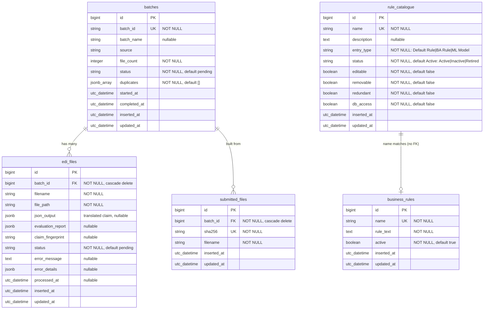
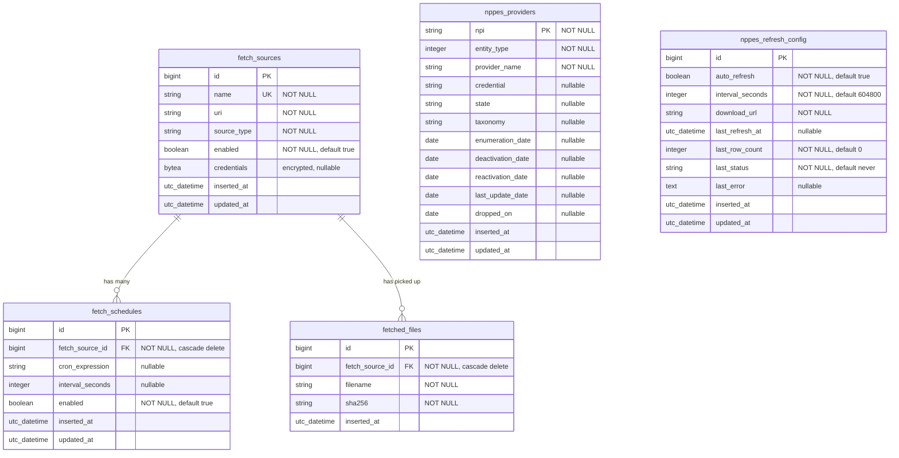
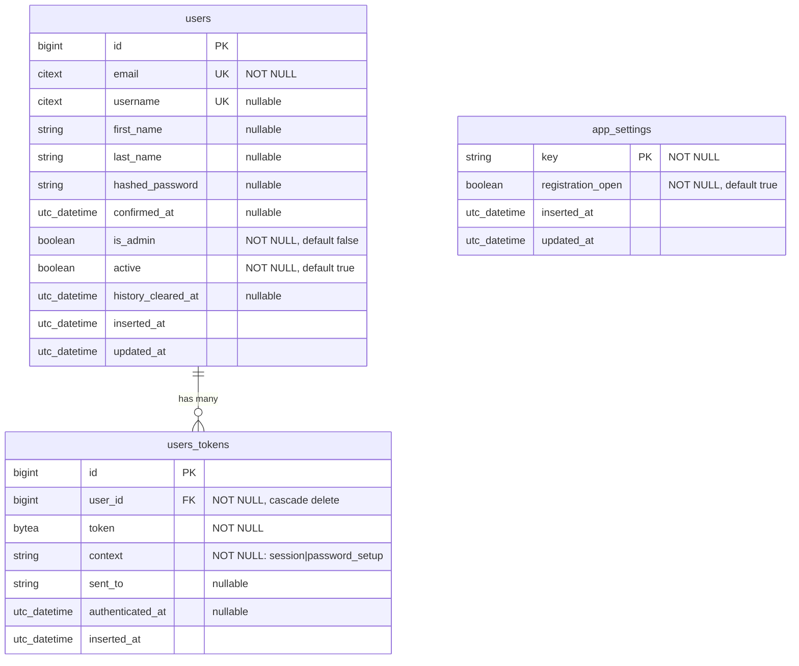

# Database Entity Relationship Diagram

The PostgreSQL tables of the Phoenix app, as created by its migrations
(`phoenix_web/priv/repo/migrations/`). Oban's own job tables (`oban_jobs`,
`oban_peers`) and Ecto's `schema_migrations` are left out.

## Claims and rules

## Ingestion and provider data

## Accounts and settings

## Relationships

All foreign keys delete in cascade: removing the parent row removes its children.

| Parent | Child | Meaning |
|---|---|---|
| `batches` | `edi_files` | One row per claim in the batch. |
| `batches` | `submitted_files` | The files the batch was built from. |
| `fetch_sources` | `fetch_schedules` | When the source is polled (cron or interval). |
| `fetch_sources` | `fetched_files` | Files the source has already picked up. |
| `users` | `users_tokens` | Log-in sessions and password-setup links. |

`rule_catalogue` and `business_rules` are linked by matching `name`, with **no
foreign key**: a catalogue entry with `entry_type = "BA Rule"` has a
`business_rules` row of the same name holding its DSL text.

## What each table holds

### Claims and rules

- **`batches`**: one row per upload or scheduled fetch: source, claim count,
  status and timestamps. `duplicates` lists each claim or file refused as
  already submitted, naming the earlier submission.
- **`edi_files`**: one row per claim. `json_output` is the translated claim as
  ingested and is never overwritten; `evaluation_report` is the engine's report
  from the latest evaluation. `claim_fingerprint` is the SHA-256 of the claim
  without its X12 envelope, used to spot the same claim in a different file.
- **`submitted_files`**: every file a batch was built from, keyed by the
  SHA-256 of its bytes (unique), so a file already received is refused.
- **`rule_catalogue`**: the registry of every rule entry (Default Rule, BA
  Rule, ML Model) with its description, status (Active, Inactive or Retired)
  and what may be done with it (edited, removed).
- **`business_rules`**: the DSL text of each BA rule and whether it is active
  in evaluation.

### Ingestion and provider data

- **`fetch_sources`**: where claim files are fetched from (SFTP, HTTP, local
  or Databricks). `credentials` is encrypted with the app's Cloak key.
- **`fetch_schedules`**: when each source is polled.
- **`fetched_files`**: files a source has already picked up, unique by
  source, name and SHA-256, so a re-fetched unchanged file is skipped; the
  same name with new content is a new file.
- **`nppes_providers`**: the imported NPPES registry used to check provider
  NPIs. `dropped_on` is the date of the first full import an NPI was missing
  from; dropped NPIs are kept so late claims can still be checked.
- **`nppes_refresh_config`**: one row: the NPPES download address, refresh
  interval (default 7 days) and the last refresh's time, status and row count.

### Accounts and settings

- **`users`**: accounts. Log-in is by email or username. `hashed_password`
  is empty for accounts made before password registration; an admin gives
  those users a password link (see [ADMIN_GUIDE.md](ADMIN_GUIDE.md)).
  `history_cleared_at` hides older batches from that user's Batch History
  without deleting them.
- **`users_tokens`**: hashed tokens. `session` tokens keep a user logged in
  (14 days); `password_setup` tokens back one-time password links (3 days).
  `sent_to` records the user's email when the token was made, so a token stops
  working if the email changes.
- **`app_settings`**: app-wide switches, today only whether registration is
  open.

## Notes

- Columns shown as `jsonb` hold JSON; `duplicates` is an array of JSON objects.
- `email` and `username` are case-insensitive (`citext`).
- Some relationships, such as catalogue entry to BA rule, are kept by the app
  rather than by database constraints.
