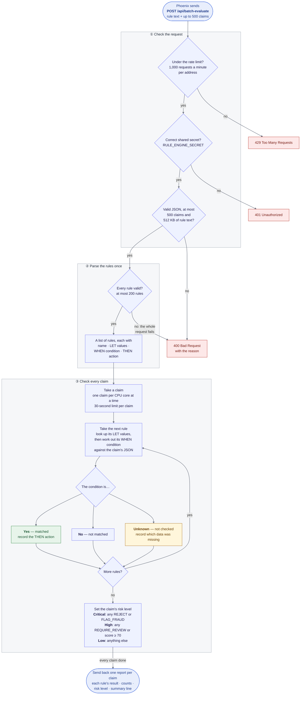

# Medicaid Claims Checker DSL Engine

Haskell-based engine for parsing, evaluating, and compiling fraud detection rules written in a domain-specific language for JSON claim payloads.

## Features

- Domain-Specific Language (DSL) for fraud detection rules
- Parser for business-analyst-friendly syntax
- Predicate evaluator for rule matching against JSON claim documents
- HTTP API server for rule parsing, evaluation, and redundancy checks
- Support for complex predicates (AND, OR, NOT, EXISTS, FORALL, COUNT, BETWEEN)
- Named quantifier variables for nested quantifier correlation (`EXISTS x IN path WHERE ...`)
- Domain predicates (`claim.has_diagnosis`, `claim.has_procedure`)
- Text predicates: `CONTAINS` and `MATCHES` (POSIX regex via regex-tdfa — linear time, invalid patterns rejected at parse time)
- Parser checked by QuickCheck round-trip properties against a test-only pretty-printer
- Redundancy detection across rule sets (exact duplicate, condition overlap, subsumption)

## Module Overview

| Module | Purpose |
|---|---|
| `Claims.Syntax` | AST types for rules, predicates, actions, field references, and evaluation results |
| `Claims.Parser` | Parsec-based DSL parser |
| `Claims.Evaluator` | Evaluate rules against generic JSON claim payloads, and summarise them in a report |
| `Claims.PolicyCombiner` | Merge DSL results with ML scoring into a combined policy envelope |
| `Claims.RedundancyChecker` | Detect redundant rules: exact duplicates, condition overlap, and subsumption |
| `Claims.MLClient` | HTTP client for the external ML scoring service, its result types and its settings |
| `Claims.Pipeline` | One claim evaluation end to end: rules, timeout, ML score, combined decision; and the evaluation request type |
| `Claims.ListenConfig` | Which host, port and TLS files the server uses, from the environment |

The server itself is in `app/`:

| Module | Purpose |
|---|---|
| `Main` | Startup: settings, worker pool, TLS |
| `Middleware` | Rate limit and shared-secret auth, applied to every request |
| `Routes` | HTTP routing and the request handlers |

Tests mirror this layout: `test/Claims/<Module>Spec.hs` tests `src/Claims/<Module>.hs`.

## Building

Run from the `haskell_engine` directory:

```bash
stack build
```

From repository root, equivalent:

```bash
stack --stack-yaml haskell_engine/stack.yaml build
```

## Running

Run from the `haskell_engine` directory:

```bash
stack run
```

From repository root, equivalent:

```bash
stack --stack-yaml haskell_engine/stack.yaml run
```

The server starts on `http://127.0.0.1:8080`. Every request except
`/api/health` needs `Authorization: Bearer $RULE_ENGINE_SECRET`.

### Listening and TLS

| Variable | Default | Meaning |
|---|---|---|
| `ENGINE_HOST` | `127.0.0.1` | Address to listen on |
| `ENGINE_PORT` | `8080` | Port to listen on |
| `RULE_ENGINE_TLS_CERT`, `RULE_ENGINE_TLS_KEY` | unset | Certificate and key files; when both are set the engine serves HTTPS |

Without a certificate the engine serves plain HTTP and only on a loopback
address (`127.0.0.1`, `localhost`, `::1`). Setting `ENGINE_HOST` to anything
else without the two TLS variables stops the server at startup, so the shared
secret and claim data never cross a network in cleartext.

When Phoenix and the engine run on the same machine, nothing needs setting.
When they run on different machines:

1. On the engine host, set `ENGINE_HOST=0.0.0.0` (or the interface address)
   and the two TLS variables.
2. On the Phoenix host, set `RULE_ENGINE_URL=https://<engine-host>:8080`.
   If the certificate is self-signed or from an internal CA, also set
   `RULE_ENGINE_CA_CERT` to the CA file; a certificate from a public CA needs
   nothing more.

`gen-dev-tls.sh [host ...]` writes a development CA (`priv/tls/ca.pem`, for
`RULE_ENGINE_CA_CERT`) and an engine certificate signed by it (`cert.pem`,
`key.pem`) covering `localhost`, `127.0.0.1` and any hosts given. Phoenix
rejects a lone self-signed certificate even when told to trust it, so use a
CA-signed one.

## API Endpoints

| Endpoint | Method | Description |
|---|---|---|
| `/api/health` | GET | Health check |
| `/api/parse-rule` | POST | Parse DSL rule text and return AST |
| `/api/evaluate` | POST | Evaluate rules against a JSON claim payload |
| `/api/batch-evaluate` | POST | Evaluate one ruleset against many claim payloads |
| `/api/check-redundancy` | POST | Compare a new rule with existing rules for duplicates, overlap and conflicts |

## Fraud Detection Scoring

The UI shows, per evaluated claim under **Fraud Detection Details**, the number of rules triggered, a weighted score, the overall risk level, the triggered rules, and any rules that could not be checked.

### Overall risk level

A classification derived from the *actions* of the matched rules, not just their count. The `determineRiskLevel` function in `Evaluator.hs` computes it, looking inside composite actions:

| Level | Condition |
|---|---|
| CriticalRisk | Any matched rule has `REJECT` or `FLAG_FRAUD` |
| HighRisk | Any matched rule has `REQUIRE_REVIEW`, or a `RISK_SCORE` of 70 or more |
| LowRisk | Anything else |

The app counts HighRisk and CriticalRisk claims as flagged for analyst review. `MediumRisk` is kept in the report format for stored reports but is not currently produced. A claim can trigger several rules and remain LowRisk if none of them asks for review or scores 70 or more.

### Rules not checked

A rule whose condition depends on missing or unusable data does not match. Its result has `resultUndecided: true` and its `resultDetails` names the fields that were missing or unusable, the report's `undecidedRules` counts such rules, and the app lists them as not checked instead of calling the claim clean. See the Missing data section of `docs/SYNTAX_GUIDE.md`.

## How the Engine Checks a Batch of Claims

What happens to one `POST /api/batch-evaluate` request from Phoenix. GitHub
draws the chart below; in VS Code, the markdown preview needs the
*Markdown Preview Mermaid Support* extension.



| Step | Where the code is |
|---|---|
| ① Check the request | `app/Middleware.hs` (rate limit, shared secret), then `handleBatchEvaluate` in `app/Routes.hs` (size limits) |
| ② Parse the rules once | `loadRules` in `src/Claims/Parser.hs`, building the types in `src/Claims/Syntax.hs` |
| ③ Check every claim | `evaluateClaim` (the 30-second limit) in `src/Claims/Pipeline.hs`; `evaluateSimpleJson`, `evaluateRuleSimple`, `evaluateWithEnv` and `determineRiskLevel` in `src/Claims/Evaluator.hs` |

The rules are parsed on every request and run directly against the claim
JSON; no Haskell code is generated. A claim that runs past 30 seconds gets an
error entry instead of a report, and the rest of the batch carries on.

**Unknown** is what keeps missing data from rejecting a claim by accident: a
rule fires only on a definite Yes. `Unknown AND No` is No and
`Unknown OR Yes` is Yes, as in SQL. See [Rules not checked](#rules-not-checked)
above.

The batch path does not use the ML score. `PolicyCombiner` and `MLClient`
run only for the single-claim `/api/evaluate`.

## License

Proprietary — All rights reserved.

No permission is granted to use, copy, modify, or distribute this software without prior written consent from the copyright owner.

See the repository root LICENSE file for full terms.
