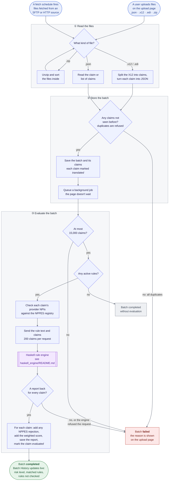

# Medicaid Claims Checker Web Frontend

Phoenix LiveView application providing the user interface for claim ingestion, rule management, batch evaluation, and fraud detection scoring.

## Where the code is

This is a standard Phoenix project: Phoenix creates the same folders in every project, which is why some names repeat the project name. You don't need to know Phoenix to find your way around.

| Folder | What it holds |
|---|---|
| `lib/` | The application code (two folders, below) |
| `test/` | The automated tests (`mix test`); same folders as `lib/` |
| `priv/` | What the running app needs that isn't code: database setup (`repo/migrations/`), the starting business rules (`repo/seeds.exs`), files the site serves (`static/`) |
| `config/` | Settings: `config.exs` for all environments, `dev.exs`, `test.exs`, `prod.exs`, and `runtime.exs` (read when the app starts, e.g. from environment variables) |
| `assets/` | The browser side: CSS and JavaScript |
| `deps/`, `_build/` | Downloaded libraries and compiled output. Not in git; never edited by hand |

All test data (claim files, rule files, expected results) is outside this folder, in [`../mock_data/`](../mock_data/README.md).

### The two folders in `lib/`

| Folder | Holds | Examples |
|---|---|---|
| `lib/medicaid_claims_checker/` | **What the app does.** Reading claims, checking providers, calling the rule engine, the database. No web pages. | `x12/` reads X12 files, `claims/` evaluates and stores claims, `nppes/` checks NPIs, `ingestion/` fetches files on a schedule |
| `lib/medicaid_claims_checker_web/` | **The web pages and URLs** people use to reach it | `live/fetch_source_live/` is the upload page (`/`), `live/rule_live/` the Rules page (`/rules`), `router.ex` maps each URL to its page |

The web folder calls the other folder, never the reverse. That's why the same processing serves an upload, a scheduled fetch and `mock_data/verify.exs`, which has no web page at all. [How a Batch of Claims Is Processed](#how-a-batch-of-claims-is-processed) below charts that path, with the file for each step.

Inside `lib/medicaid_claims_checker/`, a file and a folder with the same name go together: `claims.ex` is the entry point the rest of the app calls, and `claims/` holds the pieces behind it.

### Tests mirror the code

Every folder under `test/` matches one under `lib/`, so the tests for a file are always in the same place:

```
lib/medicaid_claims_checker/x12/claim_splitter.ex
test/medicaid_claims_checker/x12/claim_splitter_test.exs
```

`test/support/` holds setup shared by the tests: `conn_case.ex` (tests of pages), `data_case.ex` (tests that use the database), `mock_data.ex` (paths into `../mock_data/`), and `fixtures/`, which despite the name is code that creates test users, not data.

## How a Batch of Claims Is Processed

From files arriving to results on the upload page. GitHub draws the chart
below; in VS Code, the markdown preview needs the *Markdown Preview Mermaid
Support* extension. What the rule engine does with the claims is charted in
[haskell_engine/README.md](../haskell_engine/README.md#how-the-engine-checks-a-batch-of-claims).



| Step | Where the code is (under `lib/medicaid_claims_checker/` unless shown) |
|---|---|
| Files arrive | Upload: `process_manual_upload` in `lib/medicaid_claims_checker_web/live/fetch_source_live/index.ex`. Schedule: `ingestion/fetch_runner.ex`, run by `scheduler.ex`, fetching through `ingestion/remote_fetcher.ex` |
| ① Read the files | `x12/claim_splitter.ex` splits X12 into claims; `x12/converter.ex` (with `parser.ex`, `segment_mapper.ex`) turns each into JSON; `claims/json_claim.ex` reads `.json` files |
| ② Store the batch | `Claims.ingest_batch` in `claims.ex`: one database transaction that refuses duplicate claims, saves the rest and queues the job |
| ③ Evaluate the batch | `workers/batch_evaluation_worker.ex` runs `Evaluator.evaluate_batch` in `claims/evaluator.ex`, which calls the engine through `claims/engine_client.ex` |
| Results | `Evaluator` announces *completed* or *failed*; the upload page is listening and refreshes Batch History |

A claim whose provider fails the NPPES check is still sent to the engine. The
NPPES rejection is added to its report afterwards, so the report shows the
rule results as well.

## Features

- Scheduled X12 file ingestion via configured SFTP/HTTP sources with cron or interval-based schedules
- Manual file upload with in-process X12/EDI-to-JSON translation (supports `.json`, `.x12`, `.edi`, `.zip`)
  - Every file holds one or more claims. A `.json` file holds one claim (an object with `claim_id`, or the X12 converter's output with a `claim` object) or a list of them (`[...]` or `{"claims": [...]}`); claims from a multi-claim file are listed as `<file>_<claim_id>.json`, as split X12 claims are. Files with no claim, and list entries that are not claims, are refused and named in the upload message
- NPPES provider database with configurable auto-refresh (weekly by default)
- NPPES check: a claim whose provider NPI isn't in the registry, or wasn't active on the date of service, gets a rejection in its report alongside the rule results
- Business rule catalogue with type-based management (Default Rules, BA Rules, ML Models)
- In-browser DSL editor with real-time syntax validation and redundancy detection
- Batch evaluation history with per-claim risk level, matched rule details, and rules not checked because of missing data
- Risk-level display (CriticalRisk, HighRisk, LowRisk); HighRisk and CriticalRisk claims are flagged for analyst review

## Pages

| Route | LiveView | Purpose |
|---|---|---|
| `/` | `FetchSourceLive.Index` | Fetch source and schedule management, NPPES config and refresh, manual file upload, batch history |
| `/rules` | `RuleLive.Index` | DSL editor, rule evaluation, redundancy checking |
| `/admin` | `AdminLive` | User accounts (admins only) |

Development-only route: `/dev/dashboard` (Phoenix LiveDashboard). The app sends no email.

## API Endpoints

| Route | Purpose |
|---|---|
| `GET /api/health` | Liveness check |
| `GET /api/fetch-config` | Return active fetch source configuration (JSON) |

## Database Tables

See [docs/DATABASE_ERD.md](../docs/DATABASE_ERD.md): every table, its columns and how they relate.

## Backend Integration

The frontend calls the Haskell engine at `http://localhost:8080` with Req, through `lib/medicaid_claims_checker/claims/engine_client.ex`.

| Endpoint | Method | Purpose |
|---|---|---|
| `/api/parse-rule` | POST | Validate DSL syntax without execution |
| `/api/batch-evaluate` | POST | Evaluate claims against active rules (chunked at 200 claims/request) |
| `/api/check-redundancy` | POST | Detect overlap between a candidate rule and existing rules |

Request payloads are built by `PayloadBuilder` (`lib/medicaid_claims_checker_web/live/rule_live/payload_builder.ex`).

## Setup

Prerequisites: Elixir >= 1.15, PostgreSQL.

```bash
cd phoenix_web
mix setup        # deps.get, ecto.create, ecto.migrate, seeds, assets
```

Seed data loads 24 catalogue entries (11 Default Rules, 10 BA Rules, 3 ML Models) and the DSL text for 19 of them in `business_rules`. The header of `priv/repo/seeds.exs` explains what re-running the seeds overwrites.

## Running

From the repository root:

```bash
./start.sh --frontend       # port 4000, background
./start.sh --frontend -f    # port 4000, foreground
```

Or directly:

```bash
cd phoenix_web
mix phx.server              # http://localhost:4000
```

Health check: `GET http://localhost:4000/api/health`

## License

Proprietary — All rights reserved.

No permission is granted to use, copy, modify, or distribute this software without prior written consent from the copyright owner.

See the repository root LICENSE file for full terms.
